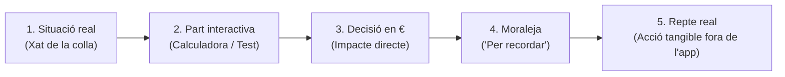

# Curs de Finances per a Joves (16–18 anys)
## Guia Pedagògica, Índex Reorganitzat i Guió dels Capítols

> **Document de treball:** Versió actualitzada (octubre 2026)  
> **Públic objectiu:** Nois i noies de 18 anys  
> **Format:** Mòduls d'uns 8 minuts en format xat interactiu + presa de decisions en € + simuladors

---

## 1. Enfocament Pedagògic i Metodologia

El curs defuig les lliçons teòriques convencionals. Cada capítol s'estructura al voltant d'una situació real del dia a dia de l'adolescent, acompanyada per una colla d'amics amb personalitats contrastades.

### Els 5 passos de cada capítol:
1. **L'escena (Xat de la colla):** Conversa en format missatgeria mòbil. Els amics debaten un dilema quotidià i introdueixen la teoria de manera orgànica i dialògica.
2. **Part interactiva:** Simuladors en temps real, calculadores o qüestionaris amb feedback immediat.
3. **Decisió amb conseqüència en euros:** L'usuari tria un camí i comprova les conseqüències en la seva cartera virtual.
4. **Moraleja i màxima "Per recordar":** Una frase clau sintetitzada que resumeix el concepte bàsic per fixar la memòria a llarg termini.
5. **Repte per a la vida real:** Una tasca ràpida (d'1 a 5 minuts) per aplicar l'aprenentatge immediatament en el seu entorn físic o digital.

---

## 2. Els Personatges de la Colla

Els personatges funcionen com a arquetips naturals de qualsevol grup d'amics d'aquesta edat:

* **Tu (L'usuari):** Protagonista actiu que pren les decisions i en viu les conseqüències.
* **Nil ("L'impulsiu"):** Actua per *FOMO* (por de quedar-se fora) i desig immediat. Vol l'últim mòbil, compra a terminis i és temptat per les apostes o els guanys ràpids. Permet que l'alumne reconegui conductes impulsives sense sentir-se jutjat.
* **Marc ("El calculador"):** Li agrada fer números, comparar preus i veure el cost real de les coses en hores de feina o interessos.
* **Marta / Laia ("La prudent"):** Prioritza la tranquil·litat, el fons d'emergència i la seguretat davant de riscos innecessaris.
* **Aina ("La que s'ho mira tot"):** Crítica i perspicaç. Llegeix la lletra petita, detecta comissions amagades i alerta de les estafes digitals.
* **Pau ("El que ja ha treballat"):** Té experiència prèvia en feines temporals. Coneix la diferència entre el que et prometen i el que acabes cobrant a la pràctica.

---

## 3. Taula Resum dels Capítols Reorganitzats

El temari s'ordena en **4 blocs progressius** que acompanyen la maduració del jove, des de les primeres monedes i sortides als 16 anys fins a la majoria d'edat i el món laboral als 18 anys:

| # | Capítol | Bloc temàtic | Tema central | Estat actual |
|---|---|---|---|---|
| **1** | **El primer sou** | Bloc 1: Primers diners | Nòmina d'estiu, sou brut vs net i cost en hores de feina | **FET** |
| **2** | **Bancs, comptes i targetes** | Bloc 1: Primers diners | Compte jove, targeta de dèbit vs crèdit i comissions | **FET** |
| **3** | **M'arriba un bizum d'un desconegut** | Bloc 1: Primers diners | Estafes mòbils (Bizum invers, Wallapop) i norma d'or | **FET** |
| **4** | **On se me'n va la pasta?** | Bloc 2: El dia a dia | Despeses formiga, subscripcions i micropagaments | **FET** |
| **5** | **Quedem per anar a un concert** | Bloc 2: El dia a dia | Pressupost social, dir que no i gestionar la pressió de grup | **FET** |
| **6** | **Em volen vendre el mòbil a terminis** | Bloc 2: El dia a dia | Finançament al consum, TIN, TAE i el cost del pagament ajornat | **FET** |
| **7** | **El coixí: i si em trenco el mòbil?** | Bloc 3: Estalvi i futur | El fons d'emergència: quantitat necessària i com crear-lo | **FET** |
| **8** | **Metes: d'un viatge al carnet** | Bloc 3: Estalvi i futur | Objectius SMART d'estalvi i fites mensuals assolibles | **FET** |
| **9** | **I si ho deixo créixer?** | Bloc 3: Estalvi i futur | Interès compost vs paranys de "diners fàcils" (cripto/apostes) | **FET** |
| **10** | **La nòmina de debò** | Bloc 4: El salt als 18 | Contracte de feina, brut anual, deduccions i negociació | **FET** |
| **11** | **La Renda sense por** | Bloc 4: El salt als 18 | Declaració de l'IRPF per a joves, obligacions i esborrany | **FET** |
| **12** | **Visc sol: el cop de realitat** | Bloc 4: El salt als 18 | Emancipació: lloguer, fiances, subministraments i despeses ocultes | **FET** |

---

## 4. Detall Capítol a Capítol

### BLOC 1: Els meus primers diners (16–17 anys)

#### Capítol 1: El primer sou
* **Estat:** FET *(disponible a `capitol1-el-primer-sou.html`)*
* **Situació real:** L'usuari ha treballat a l'estiu (monitor o cambrer) i rep la primera nòmina.
* **El conflicte al xat:** Al Nil li han promès 1.400 € però al compte li n'arriben 1.298 €. Creu que li han robat diners.
* **Punt educatiu:**
  * Diferència entre sou brut i sou net.
  * Per a què serveixen les deduccions: Seguretat Social (cotitzacions, atur, baixa mèdica) i retenció d'IRPF.
  * **La regla clau:** Traduir preus a hores de treball (*"Un sopar de 30 € equival a més de 4 hores de torn"*).
* **Part interactiva:** Taula desglossada de nòmina + simulador de preus expressats en hores laborals.
* **Frase per recordar:** *"El sou brut és el que pactes; el sou net és el que arriba al teu compte. No valoris una compra pel seu preu, sinó per les hores de la teva vida que costa pagar-la."*
* **Repte real:** Tria l'últim caprici que hagis comprat de més de 25 € i calcula quantes hores de feina representa.

---

#### Capítol 2: Bancs, comptes i targetes
* **Estat:** FET *(completament implementat i interactiu a la webapp)*
* **Situació real:** Has de cobrar la feina d'estiu o guardar els estalvis i necessites obrir el teu primer compte corrent.
* **El conflicte al xat:** Al Nil el banc li ofereix uns auriculars "de regal" si contracta un compte, mentre que l'Aina avisa que té comissions de manteniment ocultes a partir dels 18 anys. A més, el Marc adverteix sobre el perill de les targetes *revolving*.
* **Punt educatiu:**
  * Diferència crítica entre **targeta de dèbit** (gastes els diners que tens al compte) i **targeta de crèdit / *revolving*** (un préstec caríssim on ajornes el pagament amb interessos sovint superiors al 20%).
  * Comissions típiques: manteniment, transferències i retirada a caixers d'altres xarxes.
  * Què canvia quan fas 18 anys i deixes de ser menor: requisits de vinculació.
* **Part interactiva:** Selector interactiu "Dèbit o Crèdit?" davant de diferents casos pràctics + comparador de comissions d'un compte jove.
* **Frase per recordar:** *"A la teva edat, només targeta de dèbit. Si un banc et regala alguna cosa per obrir un compte, llegeix la lletra petita: el regal mai és de franc."*
* **Repte real:** Mira la teva targeta (o la dels pares) i localitza si hi posa expressament "Debit" o "Credit". Comprova a l'app si el compte cobra comissió de manteniment.

---

#### Capítol 3: M'arriba un bizum d'un desconegut
* **Estat:** FET *(completament implementat i interactiu a la webapp)*
* **Situació real:** L'usuari rep una notificació de Bizum de 50 € d'un número desconegut, i tot seguit un WhatsApp angoixat demanant que li retorni els diners perquè s'ha equivocat. O bé posa a la venda una dessuadora a Wallapop i el comprador li envia una petició de pagament en lloc d'un ingrés.
* **El conflicte al xat:** El Nil vol retornar els diners immediatament per bona fe. L'Aina diu que s'esperi.
* **Punt educatiu:**
  * Mecanisme del **Bizum invers**: confondre l'opció *"Enviar diners"* amb *"Sol·licitar diners"*.
  * Estafes triangulades a plataformes de segona mà (Wallapop, Vinted).
  * **La norma d'or:** Mai fiar-se de captures de pantalla ni missatges de xat. Entrar sempre a l'app del banc per verificar el saldo real i el tipus d'operació abans de prémer cap botó.
* **Part interactiva:** Simulador visual de notificacions de Bizum reals vs. missatges trampa (has de decidir si acceptes, rebutges o comproves a l'app).
* **Frase per recordar:** *"Davant de qualsevol missatge inesperat amb diners, stop: respira, obre l'app oficial del teu banc i verifica el saldo. Ningú et regala res."*
* **Repte real:** Activa la verificació en dos passos (2FA) o empremta digital a l'app del teu banc i al teu correu principal.

---

### BLOC 2: Gestionar el dia a dia i la pressió social

#### Capítol 4: On se me'n va la pasta?
* **Estat:** FET *(completament implementat i interactiu a la webapp)*
* **Situació real:** Tenies 80 € a començament de mes, no has comprat res car ni important, però el compte és a zero.
* **El conflicte al xat:** El Nil afirma que algú li ha cobrat de més perquè no li surten els números. El grup analitza els seus moviments bancaris dels últims 30 dies.
* **Punt educatiu:**
  * Concepte de les **despeses formiga**: cafès de màquina, xiclets, menjar a domicili (*Glovo*), *skins* o micropagaments de videojocs i subscripcions mensuals no aprofitades.
  * L'efecte acumulatiu: com 2,50 € al dia es transformen en més de 900 € l'any.
  * Mètodes senzills per auditar despeses sense tornar-se boig.
* **Part interactiva:** Calculadora de despeses formiga: afegeixes els teus consums habituals i l'eina et calcula el cost mensual, anual i quants dies de vacances equivalen.
* **Frase per recordar:** *"Les grans fuites d'estalvi no solen venir de compres gegants, sinó de microdespeses diàries que no deixen rastre a la teva memòria."*
* **Repte real:** Obre la botiga d'aplicacions del teu mòbil (App Store o Google Play), ves a "Subscripcions" i cancel·la'n una que no hagis fet servir en l'últim mes.

---

#### Capítol 5: Quedem per anar a un concert
* **Estat:** FET *(completament implementat i interactiu a la webapp)*
* **Situació real:** La colla comença a planificar una sortida a un festival o concert. L'entrada costa 75 € més viatge i consumicions.
* **El conflicte al xat:** Tots estan emocionats enviant enllaços. L'usuari no té prou pressupost aquest mes i no vol demanar diners als pares ni quedar-se sol a casa.
* **Punt educatiu:**
  * Com gestionar la pressió de grup i la por al rebuig o vergonya per motius econòmics (*FOMO*).
  * Habilitats de comunicació: aprendre a dir *"Aquest pla se'm va de pressupost, però si fem un pla alternatiu m'hi apunto"*.
  * Planificar un "pressupost d'oci" tancat per endavant per no viure amb culpa.
* **Part interactiva:** Simulador de negociació social al xat: triar respostes assertives per defensar el teu pressupost mantenint el vincle amb la colla.
* **Frase per recordar:** *"Tenir el control dels teus diners vol dir decidir tu en què els gastes, no deixar que la pressió dels altres decideixi per tu."*
* **Repte real:** Fixa un import màxim per a les sortides del proper cap de setmana abans de sortir de casa i no el superis.

---

#### Capítol 6: Em volen vendre el mòbil a terminis
* **Estat:** FET *(completament implementat i interactiu a la webapp)*
* **Situació real:** Al Nil li falla la bateria del mòbil. A la botiga li ofereixen el telèfon d'alta gamma per *"només 29 € al mes durant 36 mesos"*.
* **El conflicte al xat:** El Nil diu que 29 € és una ganga i que gairebé no ho notarà. El Marc agafa la calculadora i l'Aina demana per la TAE.
* **Punt educatiu:**
  * Què és el crèdit al consum i la trampa psicològica del pagament fraccionat.
  * Diferència entre **TIN** (Tipus d'Interès Nominal) i **TAE** (Taxa Anual Equivalent, que inclou comissions i cost real total).
  * El càlcul del preu total: 29 € x 36 mesos = 1.044 € per un dispositiu que al comptat en valia 750 €.
  * Regla de decisió: no finançar béns de consum que perden valor ràpidament.
* **Part interactiva:** Calculadora de finançament: introdueixes quota mensual i mesos per calcular el preu final real i els diners regalats en interessos.
* **Frase per recordar:** *"Si has de pagar a terminis un telèfon o roba durant tres anys, és que en realitat no te'l pots permetre avui. La TAE t'ensenya el preu de la veritat."*
* **Repte real:** Explicació de la fórmula oficial de la quota segons la TAE + mètode ràpid a la botiga. L'alumne busca un producte finançat a una botiga online, calcula el preu final amb la calculadora TAE interactiva i descobreix el sobrecost en euros i en percentatge.

---

### BLOC 3: Estalvi, futur i evitar paranys

#### Capítol 7: El coixí: i si em trenco el mòbil?
* **Estat:** FET *(completament implementat i interactiu a la webapp)*
* **Situació real:** A la sortida d'un entrenament o de classe, el mòbil cau a terra i la pantalla es trenca del tot. La reparació val 160 € immediats.
* **El conflicte al xat:** Sense mòbil no pot comunicar-se ni accedir als bitllets de transport. Si no té estalvis, ha de demanar diners o quedar-se penjat.
* **Punt educatiu:**
  * Què és un **fons d'emergència** ("el coixí") i per què és la base de la tranquil·litat mental.
  * Mida recomanada per a la seva edat: entre 300 € i 500 € per a imprevistos personals.
  * La tècnica d'estalvi *"Paga't a tu primer"*: apartar una petita part del sou o paga el mateix dia que arriba, en lloc d'intentar estalviar "el que sobri a final de mes".
* **Part interactiva:** Simulador d'imprevistos: la vida et llança 3 despeses sorpresa durant un any fictici. Tens prou coixí per resistir sense demanar préstecs?
* **Frase per recordar:** *"El coixí d'estalvi no és per fer-te ric: és el preu de la teva tranquil·litat quan la vida es complica."*
* **Repte real:** Crea un racó, guardiola o subcompte a l'app del banc batejat com "Coixí d'emergència" i posa-hi els primers 10 o 20 €.

---

#### Capítol 8: Metes: d'un viatge al carnet de cotxe
* **Estat:** FET *(completament implementat i interactiu a la webapp)*
* **Situació real:** Falten 9 mesos per a l'estiu i el grup vol fer un viatge de final de batxillerat / cicle formatiu, o bé algú vol treure's el carnet de conduir (cost estimat: 800–1.000 €).
* **El conflicte al xat:** Veure una xifra de 900 € sembla inassolible per a un adolescent. El Nil es desanima i diu que no podrà venir.
* **Punt educatiu:**
  * Metodologia d'estalvi amb objectius **SMART** (Específic, Mesurable, Assolible, Rellevant i Temporalitzat).
  * Fraccionar una meta gran en micropasses: 900 € en 9 mesos són 100 € al mes, és a dir, uns 23 € a la setmana (l'equivalent a renunciar a un parell de sortides supèrflues).
  * L'automatització: programar transferències periòdiques.
* **Part interactiva:** Planificador visual d'objectius: defineixes la teva meta i la data límit, i l'eina et desglossa l'estalvi setmanal i mensual necessari amb barres de progrés.
* **Frase per recordar:** *"Un objectiu sense data ni xifra només és un desig. Quan el divideixes en setmanes, el que semblava impossible es converteix en un pla."*
* **Repte real:** Escull una meta concreta d'aquí a final d'any, fixa la quantitat exacta i escriu en un paper quants diners has de guardar cada diumenge.

---

#### Capítol 9: I si ho deixo créixer? (i el fum de fer-se ric)
* **Estat:** FET *(completament implementat i interactiu a la webapp)*
* **Situació real:** Al Nil li apareixen anuncis a Instagram i TikTok de nois en cotxes de luxe que prometen ensenyar-te a guanyar 500 € al dia amb criptomonedes, cursos de trading o apostes esportives.
* **El conflicte al xat:** El Nil vol posar els 200 € del seu coixí en una moneda recomanada per un canal de Telegram. El Pau i el Marc l'aturen i li expliquen com creixen els diners de veritat.
* **Punt educatiu:**
  * El poder de l'**interès compost**: com el rendiment genera nous rendiments al llarg del temps (per què començar als 18 anys amb pocs diners guanya a començar als 35 amb molts diners).
  * Les alertes vermelles dels *finfluencers* i les estafes piramidals: guanys assegurats, urgència, ostentació i comissions per captar amics.
  * La regla d'or de la inversió: a més rendibilitat promesa, més risc de perdre-ho tot (sense fer recomanacions de productes concrets).
* **Part interactiva:** Simulador gràfic d'interès compost: compara què passa si comences a estalviar 30 € al mes als 18 anys vs als 30 anys.
* **Frase per recordar:** *"Els diners fàcils i ràpids a internet només enriqueixen qui ven el curs o qui munta l'estafa. En finances reals, el temps sempre guanya la pressa."*
* **Repte real:** Cerca al teu feed de xarxes socials un contingut patrocinat sobre inversions o apostes i detecta'n almenys dues banderes vermelles (*red flags*).

---

### BLOC 4: El salt als 18 anys i la independència

#### Capítol 10: La nòmina de debò
* **Estat:** FET *(completament implementat i interactiu a la webapp)*
* **Situació real:** El Pau o l'usuari aconsegueixen el primer contracte laboral formal (indefinit o en pràctiques) un cop fets els 18 anys.
* **El conflicte al xat:** En una entrevista ofereixen *"18.000 € bruts l'any"*. Ningú a la colla sap quants diners nets al mes vol dir això ni com calcular les pagues extres (12 vs 14 pagues).
* **Punt educatiu:**
  * Desglossament complet d'una nòmina d'adult: base de cotització, IRPF progressiu segons tram salarial, cotitzacions d'empresa vs treballador.
  * Diferència entre prorrateig de pagues extres (12 pagues) o pagues separades (14 pagues).
  * Nocions bàsiques de conveni col·lectiu i com defensar el sou pactat sense vergonya ni por.
* **Part interactiva:** Desxifrador de nòmines: interactua amb cada línia d'un document oficial per descobrir què significa cada concepte i on van a parar els diners.
* **Frase per recordar:** *"Mai parlis de sou mensual sense aclarir si és brut o net, i en quantes pagues anuals es divideix. Els teus drets comencen entenent el contracte que signes."*
* **Repte real:** Pregunta a algú de confiança a casa com tenen repartides les pagues de la seva nòmina (12 o 14 pagues) i quina retenció d'IRPF aproximada tenen.

---

#### Capítol 11: La Renda sense por
* **Estat:** FET *(completament implementat i interactiu a la webapp)*
* **Situació real:** Arriba el mes d'abril, la televisió i les xarxes s'omplen d'anuncis de la Campanya de la Renda, i al Nil li arriba una notificació d'Hisenda. Entra en pànic pensant que ha comès un delicte.
* **El conflicte al xat:** El grup es pregunta qui té obligació de declarar, especialment si has combinat dues feines curtes d'estiu o beques.
* **Punt educatiu:**
  * Què és l'**IRPF** (un impost progressiu i solidari sobre el que guanyes).
  * Qui té l'obligació legal de fer la declaració (límits d'ingressos i la clau de tenir **més d'un pagador**).
  * Per què a molts joves **els convé fer la declaració encara que no hi estiguin obligats**: si han tingut retencions a la nòmina d'estiu, Hisenda sovint els torna diners.
  * Com accedir de forma segura a l'esborrany amb el certificat Cl@ve.
* **Part interactiva:** Arbre de decisió interactiu *"Em toca fer la declaració aquest any?"* responent a 4 preguntes clares.
* **Frase per recordar:** *"Hisenda no mossega si entens les normes. Molts joves perden diners cada any simplement per no demanar l'esborrany que els surt a retornar."*
* **Repte real:** Descarrega't l'app de l'Agència Tributària o informa't de com sol·licitar el teu codi Cl@ve / certificat digital per tenir la teva identitat oficial a punt.

---

#### Capítol 12: Visc sol: el cop de realitat de la independència
* **Estat:** FET *(completament implementat i interactiu a la webapp)*
* **Situació real:** Als 18–19 anys s'inicia l'etapa universitària o d'FP i alguns amics volen compartir pis a ciutat.
* **El conflicte al xat:** El Nil troba una habitació per 350 € i pensa que amb un sou de 500 € a mitja jornada ja té la vida solucionada. La Marta i el Pau fan la llista de despeses invisibles.
* **Punt educatiu:**
  * El cost inicial d'entrada: fiances (1 o 2 mesos), mes corrent i despeses d'agència o garantia.
  * Les despeses ocultes mensuals: llum, aigua, gas, connexió a internet, comunitat i la compra del supermercat (menjar, neteja, higiene).
  * La regla del 30%: per què el lloguer mai hauria de superar un terç dels teus ingressos nets per evitar l'ofec financer.
* **Part interactiva:** Simulador de convivència: munta el pressupost mensual compartit d'un pis per a 3 persones i descobreix quant costa realment sobreviure el primer any.
* **Frase per recordar:** *"Marxar de casa no és només pagar el lloguer: és saber que el sabó de la rentadora, l'oli i el rebut de la llum no es paguen sols. La llibertat comença amb un pressupost real."*
* **Repte real:** Fes la compra simulada d'una setmana sencera de menjar i higiene a la web d'un supermercat i mira quants diners costa omplir el carretó.

---

## 5. Taula Comparativa: Ordre Antic vs. Ordre Nou

Aquesta taula recull els motius dels canvis respecte al PDF original:

| Capítol | Posició original | Posició nova | Justificació del canvi |
|---|---|---|---|
| **Bancs, comptes i targetes** | Cap. 10 (Proposat) | **Cap. 2** | Cal entendre el compte i la targeta de dèbit abans de rebre sous (Cap. 1) o operar amb Bizum (Cap. 3). |
| **Quedem per anar a un concert** | Cap. 6 (Pendent) | **Cap. 5** | La pressió social de grup és la despesa més freqüent als 16 anys; ha d'anar abans de parlar de préstecs i crèdit. |
| **Em volen vendre el mòbil a terminis** | Cap. 3 (Pendent) | **Cap. 6** | El crèdit al consum s'entén millor un cop analitzades les despeses del dia a dia i les sortides. |
| **Metes i estalvi** | Cap. 12 (Proposat) | **Cap. 8** | Estalviar per a una meta (viatge, carnet) és el pas natural després de crear el coixí d'emergència (Cap. 7). |
| **I si ho deixo créixer? + Paranys digitals** | Cap. 9 (Pendent) | **Cap. 9** | S'enriqueix el tema de l'interès compost incorporant la detecció d'estafes de *trading*, apostes i *finfluencers*. |
| **La Renda sense por** | Cap. 11 (Proposat) | **Cap. 11** | Es confirma definitivament com a capítol clau de transició al món adult dels 18 anys. |
| **Visc sol: despeses ocultes** | Cap. 8 (Pendent) | **Cap. 12** | És la gran fita final de l'emancipació jove; ha de tancar el curs com a síntesi de tot el que s'ha après. |

---

## 6. Pautes d'Estil i Redacció per als Guionistes

Per mantenir la coherència pedagògica i narrativa a tot el curs:

1. **Llenguatge natural i genuí:** Fer servir català quotidià (*"pasta"*, *"ratllar-se"*, *"fer un pensament"*, *"clavar una clavada"*), evitant tant l'excessiu formalisme com l'argot forçat que envelleix malament.
2. **Conseqüències emocionals i pèrdua real de diners abans de la lliçó:** Mai donar la moralina d'entrada (Error → Explicació). L'usuari ha de veure com la seva cartera virtual es buida (`ChatEngine.notifyMoneyChange`), experimentar l'angoixa de no poder pagar un pla i sentir la frustració real abans d'arribar a la solució.
3. **Personatges tridimensionals i humans (sense arquetips plans):**
   * **Nil:** No és l'ase dels cops; té sentit comú de carrer, generositat i sovint detecta les trampes comercials abans que ningú o proposa alternatives d'oci assequibles.
   * **Marta:** La seva prudència excessiva a vegades la paralitza, la fa perdre diners (por a Hisenda, amagar diners en efectiu que li roben) o l'angoixa. Aprèn a gaudir sense culpa.
   * **Marc:** Molt fort amb les matemàtiques, però rígid i tímid davant de situacions socials reals (vergonya de parlar de diners amb el cap, càlculs que fallen per imprevistos).
   * **Aina i Pau:** Tenen experiència, però confessen els seus propis fracassos de principiants (subscripcions oblidades, estafes a Wallapop, hores extres no cobrades).
4. **Decisions tangibles amb impacte a la cartera:** En la part interactiva, cada decisió afecta el saldo virtual immediatament (vermell / verd) acompanyat de vibració hàptica.
5. **Sense paternalisme:** No jutjar els desitjos del jove; mostrar-li el cost real de cada camí perquè decideixi lliurement amb informació transparent.
